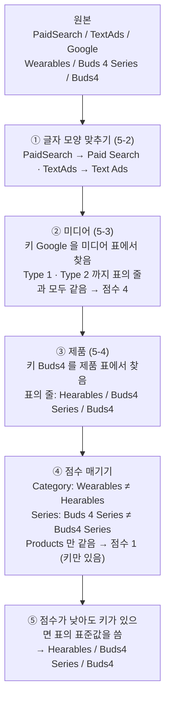
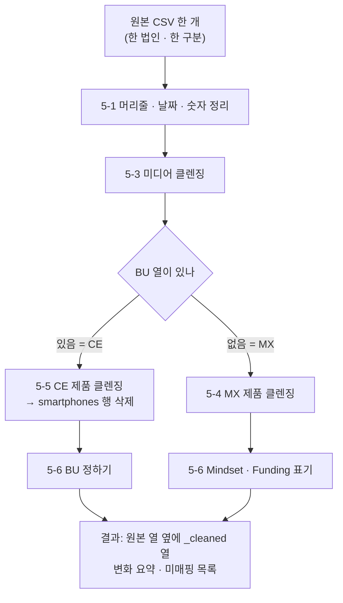

# GMO Weekly Report 자동화 설명

매주 법인에서 받은 GMO 원본을 **클렌징 → 취합본 → 메일**까지 만드는 프로그램이 무엇을 받아서, 무엇을 하고, 무엇을 내놓는지 설명합니다. 프로그램을 쓰는 사람을 위한 문서이며, 코드를 몰라도 읽을 수 있게 썼습니다.

- 코드 · 함수 단위 설명은 개발자용 문서 [클렌징로직.md](클렌징로직.md)(클렌징 코어)와 [README](../README.md)(운영 · 명령)에 있습니다. 현재 상태와 이력은 [작업이력.md](작업이력.md).
- 프로그램 위치: `C:\GMO_Cleansing\GMO클렌징_GUI.cmd` (바탕화면 바로가기 **Weekly Report**)
- 기준: 2026-10-23

---

## 1. 한 줄 요약

**사람이 법인 메일 첨부를 국가별 weekly 폴더에 저장하고 [▶ 전체 실행]을 누르면, 프로그램이 약 2분 동안 원본 수집 · 클렌징 · 취합본 · 검증 · 폴더 표시 · 백과사전 기재 · 메일 본문까지 만들고, 사람은 경고를 확인하고 메일을 보냅니다.** 회차 실행에는 AI 가 쓰이지 않습니다. 같은 파일을 넣으면 언제 돌려도 같은 결과가 나옵니다.


| 단계 | 시간(2026-10-23 W43 CE 5개 법인 시험) |
|---|---:|
| 수집 · 클렌징 | 21초 |
| 취합 검증 | 3초 |
| 취합본 만들기 | 28초 |
| 폴더 표시 · 클렌징본 | 44초 |
| 백과사전 기재 | 12초 |
| 메일 본문 | 2초 |
| **합계** | **110초** |

자동화 전에는 회차당 약 2시간(19단계, 법인마다 반복하는 손 작업 약 43번)이었습니다. 비교표는 `docs/성과_전후비교.xlsx`.

---

## 2. 프로그램 화면


| 영역 | 하는 일 |
|---|---|
| 위쪽 주차 · 구분 | 작업할 주차(기본 = 이번 ISO 주차)와 구분. 홀수 주 CE · 짝수 주 MX |
| 왼쪽 **이번 주 원본** | 법인별로 이번 주 폴더에 파일이 있는지. ● 있음 · ○ 없음 · – 제출 안 하는 법인 |
| 왼쪽 **작업 순서** | ① 수집 · 클렌징 → ② 취합 검증 → ③ 취합본 → ④ 메일 → 보내기. 결과 파일을 보고 자동으로 체크되고, 지금 할 단계에 '← 지금' |
| 오른쪽 경로 | 원본 폴더(국가별 weekly), 취합 폴더, Gmail 열 곳 |
| 오른쪽 **실행** | [▶ 전체 실행] 또는 단계 버튼 하나씩. [제목 복사]는 메일 제목을 클립보드에 |
| 오른쪽 결과 버튼 | OUTPUT · Reports · 실행요약 · 취합검증 · 취합 폴더 열기 |
| 오른쪽 아래 로그 | 진행 상황. 문제는 ✖ · ⚠ 로 표시 |

---

## 3. 넣는 파일 · 쓰는 설정

### 3-1. 매주 넣는 것 — 법인 원본

| 위치 | 내용 |
|---|---|
| `G:\공유 드라이브\Samsung Perform_1\문서-1\2026\09. GMO Report\2. 국가별 weekly\<nn>주차\<MX 또는 CE>\<법인 MMDD>\` | 법인이 보낸 엑셀(xlsx · xlsm) 또는 zip. MMDD = 받은 날짜 |

- 파일 이름을 바꿀 필요가 없습니다. 프로그램이 **파일 안의 시트**를 열어 `Subsidiary` · `Media Platform` 머리줄이 있는 GMO 시트를 찾습니다. 시트가 여러 개면 날짜가 가장 최근까지 있는 시트를 씁니다.
- zip 은 프로그램이 열어 안의 엑셀을 읽습니다.
- 같은 종류 파일이 여러 폴더에 있으면 **최신 폴더 것**을 쓰고, 최신 파일에 없는 날짜만 이전 파일에서 채웁니다(예: SEDA 1020 의 AWIN 10/1~18 이 있으면 SEDA 1014 의 AWIN 10/1~11 은 안 씀).
- `- 복사본` 파일, 구분이 다른 파일(CE 폴더 안의 `- MX -` 파일), DCT 폴더는 읽지 않습니다.
- 손으로 받은 CSV 는 `클렌징.cmd` 위에 끌어다 놓아도 됩니다.

### 3-2. 미리 정해 둔 표 — `C:\GMO_Cleansing\3_Config\`

| 파일 | 내용 | 바꾸는 때 |
|---|---|---|
| `media_mapping_MASTER.xlsx` | 미디어 매핑: 원본 Media Platform → 표준 Type 1 / Type 2 / Platform | 거의 없음(표준표로 관리, 아래 5-8) |
| `product_mapping_MX.xlsx` | MX 제품 매핑: 원본 Products → 표준 Category / Series / Products (약 560행) | 신제품이 나올 때 |
| `product_mapping_CE.xlsx` | CE 제품 매핑: 원본 Product Category → 표준 Category / Series (약 70행) | 새 카테고리 표기가 들어올 때 |
| `media_taxonomy.csv` | D2C 미디어 표준표(쓸 수 있는 Type 1 · Type 2 · Platform 조합) | 표준이 바뀔 때 |
| `campaign_rules.xlsx` | 캠페인명으로 제품을 채우는 규칙 | 새 캠페인 코드가 생길 때 |
| `tracker_markets.csv` | Collection status 표의 법인 목록 · 제출 여부 · 고정 사유 | 법인 계약이 바뀔 때 |
| `reminder_links.csv` | 리마인드 보류 법인(제외 = O) 등 | 리마인드를 잠시 멈출 때 |

매핑 등록은 엑셀을 직접 고치지 않고 `매핑등록.xlsx` 에 O 표시 → `매핑등록.cmd`, 또는 명령 한 줄로 합니다(README §7). 고칠 때마다 백업이 `3_Config\_backup\` 에 남습니다.

---

## 4. [▶ 전체 실행]을 누르면 하는 일

| 순서 | 하는 일 | 결과 |
|---|---|---|
| ① 수집 | 그 주차 폴더에서 법인별 GMO 시트를 읽어 한 법인 · 한 구분당 CSV 하나로 모읍니다. 머리줄 이름 차이 · 밀린 열 · 표기(S.com · GMO · DA)를 맞춥니다(5-7) | `1_Input\<법인>_CE.csv` 등 |
| ① 점검 | 매핑 엑셀이 열려 있는지, 같은 법인 파일이 두 개인지, 형식이 아닌 파일이 있는지 봅니다. 문제가 있으면 여기서 멈춥니다 | 로그 |
| ① 매핑 자동 추론 | 매핑 표에 없는 원본 값 중 규칙으로 확실한 것만 매핑 엑셀에 행을 더합니다(5-9) | 매핑 엑셀 |
| ① 클렌징 | **기존 클렌징 로직**(5장)으로 날짜 · 숫자 · 미디어 · 제품 · BU 를 표준값으로 바꾸고, 그 위에 캠페인 역추적 · 미디어 표준표를 얹습니다 | `2_Output\cleaned_*.csv` |
| ① 마스터 갱신 | 법인별로 숫자가 처음 달라진 날부터 이번 결과로 교체합니다(6장) | `TOTAL_MASTER_MX/CE.csv` |
| ① 제안 · 요약 | 처음 보는 값 · 캠페인 코드를 Spend 큰 순으로 정리합니다 | `Reports\매핑등록.xlsx` · `캠페인규칙제안.xlsx` · `실행요약.md` |
| ② 취합 검증 | 최신 취합본과 이번 결과를 합쳐 12가지를 검사합니다(7장). 오류면 ③을 하지 않습니다 | `Reports\취합검증_<구분>.md` |
| ③ 취합본 | 이전 취합본을 `old RAW files` 로 옮기고 새 버전을 만듭니다. RAW 교체 · 피벗 새로고침 · Collection status Tracker | 공유 드라이브 `3. Weekly Dashboard RAW File\D2C\` |
| ③ 폴더 표시 | 국가별 weekly 폴더에 `_A` · `XXX` 꼬리표, 원본 옆에 `허겸수정(MMDD~)_a` 클렌징본(8장) | 국가별 weekly 폴더 |
| ③ 백과사전 | GMO 백과사전 Status Check 시트에 받은 날짜 · 정리 · 취합 O(8장) | `4. Standard\★★GMO 백과사전` |
| ④ 메일 | PCG 주간 메일 본문을 클립보드에 넣고 지난주 메일을 엽니다. 미제출 법인 리마인드 문구를 만듭니다(9장) | `Reports\메일_W<nn>.html` |

- 매번 실행 전에 원본을 백업합니다: 마스터 `2_Output\Backup\`, 입력 `1_Input\_보관\`, 백과사전 `2_Output\Backup\백과사전_<시각>.xlsx`, 취합본 `old RAW files\`.
- 폴더 표시 · 백과사전 기재가 실패해도 ④ 메일은 계속 진행하고 로그에 ✖ 로 남깁니다.

---

## 5. 클렌징 — 기존 로직이 하는 일

이 장이 이 프로그램의 핵심입니다. 법인마다 제각각으로 적어 보내는 미디어 · 제품 값을 하나의 표준으로 모으는 일을 **기존 클렌징 로직**(`src/pipeline.py`)이 합니다. 2026-10 자동화 때도 이 로직은 한 줄도 바꾸지 않았고(자동화 전 결과와 바이트 단위로 같음), 새 기능(5-7 이후)은 모두 이 로직의 앞뒤에 붙였습니다.

### 5-A. 한 회차에서 실제로 한 일

최근 두 회차의 원본과 클렌징 결과(`cleaned_*.csv`)를 그대로 비교한 숫자입니다. 표기만 다른 것을 맞춘 것도 '바뀐 행'에 포함했습니다. W42 MX(10/13)는 덧붙인 단계(5-7~5-9)가 생기기 전 실행이라 순수하게 기존 로직의 결과이고, W43 CE(10/20)에는 미디어 표준표 · 캠페인 역추적 몫이 조금 섞여 있습니다.

| | W43 CE (5개 법인) | W42 MX (6개 법인) |
|---|---:|---:|
| 행 | 17,012 | 87,016 |
| 미디어 · 제품 칸이 하나라도 바뀐 행 | **15,866 (93%)** | **27,449 (32%)** |
| 그 행들의 Spend | $269만 / 전체 $283만 | $1,396만 / 전체 $1,858만 |
| Media Type 2 표기 종류 | 23종 → 표준 14종 | 25종 → 표준 17종 |
| Product Category 표기 종류 | 19종 → 표준 11종 | 11종 → 표준 8종 |
| Product Series 표기 종류 | 16종 → 표준 7종 | 60종 → 표준 27종 |
| Products 표기 종류 | — (CE 는 원본 유지) | **120종 → 표준 56종** |

이 숫자 뒤에 있는 실제 장면들:

| 법인 | 원본 | 클렌징 결과 | 행 · Spend |
|---|---|---|---|
| SIEL MX | Media Type 2 `TextAds` | `Text Ads` | 7,397행 · $272만 |
| SIEL MX | Media Type 2 `StandardsAds`(오타) | `Standard Ads` | 1,712행 · $53만 |
| SETK MX | Media Type 2 `Standart Ads`(오타) | `Standard Ads` | 584행 · $44만 |
| SIEL MX | `Wearables / Buds 4 Series / Buds4` | `Hearables / Buds4 Series / Buds4` — **카테고리가 틀린 것까지** | 684행 · $16만 |
| SEC MX | `Wearables / Buds4 Series / Buds4 Series` | `Hearables / Buds4 Series / Buds4 Series` | 660행 · $11만 |
| SIEL MX | Products `A36` · `A17` · `A56`, Series `Aseries` | `Smartphones / A Series / A Series` | 252행 · $2.2만 |
| SEPR MX | Category 빈 칸, Products `epp` · `web` · `app` | `Multi / Multi / Multi` | 916행 · $102만 |
| SIEL CE | Media Type 1 `ShoppingAds`, Type 2 `PerformanceMax` | `Shopping Ads / Performance Max` | 7,844행 |
| SIEL CE | Category `Washing Machine` · `Soundbar` · `Oven` | `Washer` · `Sound device` · `Cooking` | 4,666행 |
| 여러 법인 | Platform `TikTok` · `Tiktok` · `tiktok` | `Tiktok` 하나로 | |

사람이 하면 법인마다 필터를 걸고 값을 하나씩 고치던 일입니다(자동화 전 수작업 기준 법인 하나에 15~65분). 이 로직은 위 일을 법인당 몇 초(1만 3천 행인 SIEL CE 도 약 2초)에 하고, 같은 원본이면 언제나 같은 답을 냅니다.

### 5-B. 한 행 따라가기

SIEL MX 원본의 실제 한 행(2026-02-26)이 어떻게 바뀌는지 처음부터 끝까지 따라가 봅니다.

| 칸 | 원본 | 결과 |
|---|---|---|
| Media Type 1 | `PaidSearch` | `Paid Search` |
| Media Type 2 | `TextAds` | `Text Ads` |
| Media Platform | `Google` | `Google` |
| Product Category | `Wearables` | `Hearables` |
| Product Series | `Buds 4 Series` | `Buds4 Series` |
| Products | `Buds4` | `Buds4` |



이 한 행에서 일어난 일:
- `PaidSearch` 처럼 붙여 쓴 말은 **비교하기 전에 띄어 쓴 모양으로 바꿔** 표와 맞춥니다. 그래서 매핑 표에 `PaidSearch` 줄을 따로 만들 필요가 없습니다.
- 법인이 Category 를 `Wearables` 로 잘못 적어 보냈지만, **제품명(Buds4)을 기준으로 찾기 때문에** 제품 표가 아는 정답(Hearables)으로 바로잡힙니다. 원본 Category · Series 는 '어느 줄을 고를지' 판단하는 데만 쓰입니다.
- 같은 제품명이 표에 여러 줄 있었다면(5-4 의 `Watch Ultra` 처럼) 원본 Category · Series 가 더 많이 맞는 줄을 골랐을 것입니다. **원본이 틀려도 바로잡고, 원본이 맞으면 그 단서로 더 정확한 줄을 고르는** 구조입니다.

### 5-C. 단계 흐름

여기부터는 위 장면들이 어떤 단계와 규칙으로 만들어지는지 단계별로 자세히 적습니다.



- **MX 인지 CE 인지는 `BU` 열이 있는지로** 정합니다. CE 원본에는 BU(DA · VD) 열이 있습니다.
- 매핑은 모두 3_Config 의 매핑 엑셀(3-2)을 읽어서 합니다. 코드에 제품 이름이 박혀 있지 않습니다. 그래서 신제품은 **매핑 엑셀에 행을 더하는 것**으로 처리합니다.

### 5-1. 머리줄 · 날짜 · 숫자 정리

| 대상 | 하는 일 | 예 |
|---|---|---|
| 머리줄 | 보이지 않는 문자 · 줄바꿈 · 따옴표 · 겹친 띄어쓰기를 지웁니다. 같은 이름이 두 번 나오면 앞의 것만 씁니다 | `"Media\nPlatform "` → `Media Platform` |
| 머리줄 이름 차이 | 다른 이름으로 쓴 숫자 열을 표준 이름으로 | `Revenue (USD)` · `Total Revenue` → `Revenue`, `Cost` → `Media Spend (USD)` |
| 날짜 | 엑셀 숫자 날짜(46302)와 글자 날짜(2026/10/07 등)를 모두 읽어 `2026-10-07` 로. 읽을 수 없는 날짜, **2026-01-01 이전 행은 버립니다**(2026 년만 추적) | `46302` → `2026-10-07` |
| Week · Month · Quarter | 날짜로 **다시 계산**합니다. Week = ISO 주차, Month = 영어 월 이름 | 원본 Month 칸에 `outubro` 가 있어도 → `October` |
| 숫자 | 쉼표를 빼고 숫자로. 빈 칸 · 글자 · `-` 는 0 | `1,234` → `1234`, `-` → `0` |
| CPC | Spend ÷ Clicks 로 다시 계산. Clicks 가 0 이면 0 | |

### 5-2. 글자 모양 맞추기 (매핑 표와 비교하기 전에)

원본 값마다 표기가 달라 매핑 표와 그대로 비교하면 잘 맞지 않습니다. 그래서 비교 전에 모양을 맞춥니다.

| 규칙 | 원본 | 바뀐 모양 |
|---|---|---|
| 소문자 다음 대문자 사이를 띄움 | `TikTok` | `Tik Tok` |
| 약어 다음 단어 사이를 띄움 | `QLEDUltra` | `QLED Ultra` |
| 숫자 다음 글자 사이를 띄움 | `s25ultra` | `s25 ultra` |
| 전부 소문자이거나 전부 대문자면 단어 첫 글자만 대문자 | `s25 ultra` · `S26 FE` | `S25 Ultra` · `S26 Fe` |

- 이미 대소문자가 섞인 값(`Z Fold7`)은 그대로 둡니다.
- 매핑 표의 키도 이 모양으로 적어야 맞습니다. 예: TikTok 은 `Tik Tok` 으로 등록돼 있습니다.
- MX 제품 · 미디어는 대소문자까지 같아야 맞고(`Tab S10 Fe` ≠ `Tab S10 FE`), CE 제품은 대소문자를 무시합니다.

### 5-3. 미디어 클렌징

**찾는 칸**: 원본 `Media Platform`. 단 `Media Type 1` 이 **Affiliate** 인 행은 `Media Type 2`(Coupon · Cashback 등)로 찾습니다.

미디어 매핑 표의 한 줄 = "이 키가 오면 Type 1 / Type 2 / Platform 을 이것으로":

| 키 | 표준 Type 1 | 표준 Type 2 | 표준 Platform |
|---|---|---|---|
| Google | Paid Search | Text Ads | Google |
| Meta | Paid Social | Standard Ads | Meta |
| Meta | Paid Social | Dynamic Ads | Meta |
| Meta | App | App Install | Meta |
| Cashback | Affiliate | Cashback | NONE |

같은 키가 여러 줄이면(Meta 처럼) 원본의 Type 1 · Type 2 와 **가장 많이 맞는 줄**을 고릅니다(점수 방식은 5-4 와 같음). 원본이 `Paid Social / Dynamic Ads / Meta` 면 두 번째 줄이 골라집니다.

| 상황 | 결과 |
|---|---|
| 키를 찾음 | 그 줄의 표준값 |
| Affiliate 이고 Type 2 키를 찾음 | Type 1 · Type 2 는 표준값, **Platform 은 원본 그대로**(Awin · Optimise 등 제휴사 이름을 지키려고) |
| 키를 못 찾음 | 원본 그대로 두고 미매핑 목록에 올림 |
| Affiliate 인데 Type 2 키를 못 찾음 | Type 2 = `Others`, Platform 은 원본 |

> 그 뒤에 **미디어 표준표 검사**(5-8)가 한 번 더 돌아 표 밖 조합을 Others 로 정리합니다.

### 5-4. MX 제품 클렌징

**찾는 칸**: 원본 `Products`. MX 제품 매핑 표의 한 줄:

| 키(원본 Products) | 표준 Category | 표준 Series | 표준 Products |
|---|---|---|---|
| S25 Ultra | Smartphones | S25 Series | S25 Ultra |
| Z Fold7 | Smartphones | Z Fold7 | Z Fold7 |
| Watch8 | Wearables | Watch8 Series | Watch8 |
| Watch Ultra | Wearables | Watch7 Series | Watch Ultra |
| Watch Ultra | Wearables | Watch8 Series | Watch Ultra |
| 9100 Pro | APS | APS | SSD |

**① 줄 고르기 — 점수.** 원본 Products 로 키를 찾은 뒤, 원본의 Category · Series 가 그 줄과 얼마나 맞는지로 점수를 매겨 가장 높은 줄을 씁니다.

| 점수 | 조건 |
|---|---|
| 4 | Category · Series · Products 모두 같음 |
| 3 | Category · Series 같음 |
| 2 | Series 만 같음 |
| 1 | 키만 있음(나머지는 다름) |
| 0 | 키가 표에 없음 |

예: 원본 `Wearables / Watch8 Series / Watch Ultra` → 키 `Watch Ultra` 줄이 둘인데, Series 까지 맞는 두 번째 줄(점수 3 이상)을 씁니다. 원본 Series 가 비어 있으면 둘 다 점수 1 이라 **표에서 위에 있는 줄**이 골라집니다. 그래서 같은 키를 여러 줄 둘 때는 순서가 중요합니다.

**② Multi 구제.** ①의 결과 Category 가 `Multi` 이거나 비었으면, 원본의 Series · Category 로 다시 찾습니다.

| 순서 | 방법 | 예 |
|---|---|---|
| 1 | 원본 Series 가 표준 Series 에 있으면 그 Category · Series | 원본 `Smartphones / S25 Series / Multi` → `Smartphones / S25 Series / S25 Series` |
| 2 | 원본 Category 가 표준 Category 에 있으면 그 Category 의 `Other…` 시리즈(없으면 Multi) | 원본 `Wearables / (처음 보는 시리즈) / …` → `Wearables / Other Wearables` |
| 3 | 원본 Category 칸에 시리즈 이름이 들어 있으면 그 시리즈로 | |

구제되면 Products 칸에는 시리즈 이름이 들어갑니다.

**③ 이미 표준이면 그대로.** 원본의 Category / Series / Products 세 칸 조합이 매핑 표에 있는 표준 조합과 똑같으면, 위 결과와 상관없이 원본을 그대로 둡니다(불필요하게 바꾸지 않으려고).

**④ 미매핑.** 키가 없고(점수 0), 구제도 안 됐고, 이미 표준도 아닌 것만 `Reports\Unmapped_Products.csv` 에 남깁니다.

> 주의: **구제된 신제품은 미매핑 목록에 나오지 않습니다.** 예를 들어 처음 보는 `Z Fold9` 가 Smartphones 로 구제되면 목록에 없습니다. 그래서 자동화에서는 원본에 매핑 키가 있는지 따로 확인하는 매핑 제안(5-9)을 만들었습니다.

### 5-5. CE 제품 클렌징

CE 는 원본 `Products` 가 비어 있거나 제각각이어서 **Product Category 를 키로** 찾고, Series 는 그 카테고리 안에서 맞춥니다. 원본 Products 칸은 바꾸지 않습니다.

CE 제품 매핑 표의 일부:

| 키(원본 Category) | 표준 Category | 표준 Series |
|---|---|---|
| TV | TV | Neo QLED |
| TV | TV | QLED |
| TV | TV | UHD |
| Washing Machine | Washer | … |
| Soundbar | Sound device | … |
| Epp · App · S.com · Web | Multi | Multi |

| 상황 | 결과 | 예 |
|---|---|---|
| 카테고리를 찾고, 원본 Series 가 그 카테고리의 표준 Series 에 있음 | 표준 Category · Series | `TV / qled` → `TV / QLED` |
| 카테고리를 찾았지만 Series 가 없음 | 그 카테고리의 `Others`(없으면 `Multi`) | `TV / (빈 값)` → `TV / Others` |
| 카테고리를 못 찾았지만 원본 Series 가 **한 카테고리에만 있는** 표준 Series | 그 카테고리 · Series | `(엉뚱한 카테고리) / Neo QLED` → `TV / Neo QLED` |
| 둘 다 못 찾음 | 원본 그대로 두고 미매핑 목록에 올림 | |

- 여러 카테고리에 같은 이름으로 있는 Series(예: `Others`)로는 카테고리를 짐작하지 않습니다(엉뚱한 카테고리로 가는 것을 막으려고).
- 클렌징 결과 Category 가 **smartphones** 인 행은 CE 결과에서 지웁니다(MX 데이터가 CE 파일에 섞여 들어온 것).

### 5-6. 후처리

**CE — BU 정하기.** 원본 BU 를 대문자로 맞춘 뒤(`da` → `DA`), 클렌징된 Category 로 덮어씁니다.

| BU | Category |
|---|---|
| VD | TV · Lifestyle TV · Monitor · Sound device |
| DA | Refrigerator · Washer · Dryer · Washer & Dryer · Cooking · Dishwasher · Vacuum · Air Dresser · Air Purifier · Heating & Cooling |
| MX | Smartphones · Tablets · Wearables · Hearables · PC |
| (원본 유지) | Multi · APS 등 위에 없는 것 |

**MX — 표기.** Mindset `cold` → `Cold`, Funding `gmo` / `local` → `GMO` / `Local`. Subsidiary 앞뒤 띄어쓰기 제거.

### 5-7. (자동화 + 알파) 수집 때 바로잡는 것

기존 로직에 들어가기 전, 수집 단계에서 법인 파일마다 다른 점을 맞춥니다.

| 문제 | 처리 |
|---|---|
| 머리줄 이름이 다름 | `Div` → BU, `Mon` → Month, `Local` → Funding (SETK 등) |
| 일부 행만 열 순서가 밀림(SEDA 월간 리포트) | 행마다 미디어 표준표와 비교해 Type 1 · Type 2 · Platform · Funding 자리를 바로잡음 |
| S.com 하위 채널 | Sales Channel · Partner 의 Epp · app · web → `S.com` |
| Funding 표기 | `HQ` · `D2C` → `GMO`, `SCIC` → `Local`. 그 밖 값은 ⚠ |
| BU 표기 | `HA` → `DA`. BU 열이 없는 CE(SETK)는 캠페인명의 `BS~da` · `BS~vd` 로 채움 |
| 날짜 열 이름이 없음(SIEL) | 날짜가 든 열을 Date 로 |

### 5-8. (자동화 + 알파) 미디어 표준표

D2C 미디어 표준표(`media_taxonomy.csv`)에 있는 조합만 쓰도록 미디어 클렌징 결과를 한 번 더 정리합니다. **미디어 매핑 엑셀에 새 플랫폼을 더하지 않습니다.**

1. 약어를 풉니다: PMAX → Performance Max, FB · IG → Meta, TTD → The Trade Desk
2. Type 1 이 표에 없으면 Type 2 로 찾습니다: Performance Max → Shopping Ads
3. Platform 이 비었거나 Other 류면 표의 기본값: YouTube → Google
4. 그래도 표 밖이면 Platform `Others`(DSP 는 `Other DSPs`). 원본 값은 `Media Platform (Raw)` 칸에 남깁니다

### 5-9. (자동화 + 알파) 매핑 자동 추론 · 캠페인 역추적

**매핑 자동 추론** — 매핑 키에 없는 원본 값 중 아래에 해당하면 매핑 엑셀에 행을 더합니다(메모 '자동'). 아니면 `매핑등록.xlsx` 에 제안만.

| 규칙 | 예 |
|---|---|
| 코드명 별칭(`3_Config\aliases.csv`)을 풀면 아는 이름 | `Q8` → Z Fold8 Ultra, `H8` → Z Fold8, `B8` → Z Flip8 |
| 기존 키와 표기만 다름 | `Tab S10 FE` → `Tab S10 Fe` 줄과 같게 |
| 표준 제품명과 같음 | |
| 표준 시리즈 이름 안에 들어 있고 후보가 하나뿐 | |
| 과거 이력에서 90% 이상 같은 분류 | |

**캠페인 역추적** — 제품 클렌징 결과가 **빈 값 · Multi · Other(s)** 일 때만, 캠페인명으로 채웁니다.

| 캠페인명 | 채우는 값 |
|---|---|
| `CN~…_PR~<제품코드>_SB~<시리즈코드>_…`(SETK · SEAU CE · SEPR) | 코드표에 따른 Category · Series |
| 키워드(`f1h26`, `gs26se` 등) | 규칙표에 따른 값 |
| S26 과 Buds 가 같이 있는 번들 | Multi |

- 원본이 이미 구체적인데 규칙과 다르면 바꾸지 않고 '충돌'로만 기록합니다(원본 우선).
- 바뀐 행은 `Campaign_Rule` 칸에 근거가 남습니다.

### 5-10. 클렌징 결과물

| 파일 | 내용 |
|---|---|
| `2_Output\cleaned_<MMDD>~_<법인>.csv` | 원본 열 옆에 `_cleaned` 열(클렌징 값)을 나란히 둔 파일. 무엇이 바뀌었는지 눈으로 비교할 때 |
| `…_Summary_Prod.csv` · `_Summary_Media.csv` · `_Summary_Campaign.csv` | 원본 값 → 클렌징 값이 몇 행씩 바뀌었는지 |
| `Reports\Unmapped_Products.csv` · `Unmapped_Media.csv` | 매핑 못 한 값 |
| `2_Output\_이번실행_<MX 또는 CE>.csv` | 이번 실행분 전체(취합 단계가 읽음) |

---

## 6. 마스터 · 취합본이 바뀌는 방식

마스터(`TOTAL_MASTER_*.csv`)와 취합본 RAW 는 같은 규칙으로 바뀝니다. **법인별로, 숫자가 처음 달라진 날부터** 이번 결과로 교체하고, 그 앞 날짜와 이번에 안 낸 법인은 손대지 않습니다.

```text
              10/01               10/12               10/18
SEPR   기존   ###########################
       이번   ....................#####################   <- 10/12 부터 숫자가 다름
       결과   ####################=====================   (= : 이번 것으로 교체)

SEAU   기존   ###########################
       이번   ...........................######           <- 겹치는 날은 숫자가 같음
       결과   ###########################======           (뒤에 이어 붙이기만)

SEI    기존   ##################                          <- 이번에 안 냄
       결과   ##################                          (그대로)
```

- 비교하는 숫자: Spend · Revenue · Impressions · Clicks · Orders(소수 둘째 자리까지).
- **분류만 바뀌면 교체되지 않습니다.** 매핑을 고친 뒤 과거 행까지 반영하려면 `매핑등록.cmd`(자동으로 다시 실행) 또는 `run_all.py --remap <법인>`.

---

## 7. 취합 검증 — 취합본을 만들기 전에 보는 것

| 항목 | 맞지 않으면 |
|---|---|
| 이번에 안 낸 법인의 행 · Spend 가 그대로인지 | **오류**(멈춤) |
| 낸 법인은 교체 시작일 앞은 그대로, 뒤는 이번 결과와 합계가 같은지 | **오류** |
| CPC = Spend ÷ Clicks 인지 | **오류** |
| 날짜: 빈 날짜 · 미래 날짜 | **오류** |
| 날짜: 2026 이전 | 경고 |
| 법인 빈 값 | 경고 |
| Funding 이 Local · GMO 뿐인지 | 경고 |
| 미디어가 표준표 안인지 | 경고 |
| 중복 행이 늘었는지(같은 데이터가 두 번 들어감) | 경고 |
| 변화가 큰 법인 | 경고 |
| 매핑 점검: 출시 전에 신제품 Spend · 분류가 바뀐 행 · Multi/Other 비중 급증 | 경고(`Reports\매핑점검_<구분>.md`) |

- **오류**가 하나라도 있으면 ③ 취합본을 만들지 않습니다. 고치고 다시 실행하면 같은 결과가 나옵니다.
- 경고는 취합본을 만들되 `취합검증_<구분>.md` 에 ⚠ 로 남깁니다. 담당자가 읽고 판단합니다.
- 취합본을 저장한 뒤에는 다시 열어 **모든 행 · 모든 열**이 계산한 것과 같은지 대조합니다.

---

## 8. 회차 끝 정리 — 폴더 표시 · 백과사전

### 8-1. 국가별 weekly 폴더 표시

| 표시 | 뜻 |
|---|---|
| 법인 폴더 `<법인 MMDD>_A` | 이번 주에 이 폴더의 값을 씀 |
| `XXX` (폴더 · 파일) | 받았지만 안 씀(최신 파일에 같은 날짜가 있어서) |
| `<원본 이름> - 허겸수정(MMDD~)_a.xlsx` | **클렌징본.** 원본은 그대로 두고 옆에 복사본을 만들어 분류 칸(미디어 · 제품 · Funding · BU · Month 등)을 클렌징 값으로 바꾼 것. 숫자 · 날짜 · 수식 칸은 원본 그대로 |

- MMDD = 그 파일 값으로 마스터가 바뀌기 시작한 날.
- zip 을 썼으면 같은 폴더에 `<zip 이름>\` 으로 풀어 두고, 클렌징본은 그 안 원본 옆에 둡니다.
- 클렌징 결과와 원본 행이 하나씩 맞지 않으면 그 파일은 클렌징본을 만들지 않습니다(로그 ⚠).

### 8-2. GMO 백과사전 Status Check

`09. GMO Report\4. Standard\★★GMO 백과사전_250327.xlsx` 의 'D2C MX Status Check' · 'D2C CE Status Check' 시트:

| 칸 | 프로그램이 쓰는 것 |
|---|---|
| 주차 칸(W01 · W02 …) | 폴더 이름의 받은 날짜를 그 날짜가 속한 주차 칸에 `MM-DD`. 예: CE `SEAU 1001` → W40 칸에 10-01. **빈 칸만** 채우고 손으로 적은 값은 그대로 |
| 주차 칸이 없으면 | '정리' 앞에 새 주차 칸을 넣음 |
| 정리 · 취합 | 매주 다 지우고 이번 주에 클렌징 · 취합한 법인만 O |
| 서식 | 2026 주차 칸 전체를 `MM-DD` 로 |

---

## 9. 메일

| 메일 | 프로그램 | 사람 |
|---|---|---|
| **PCG 주간 메일** | 제목(`[CE] 2026 W43 GMO Weekly Report`)과 본문(첨부 파일명 · Collection status 표)을 만들어 본문을 클립보드에 넣고, 보낸편지함에서 지난주 메일을 엽니다 | 지난주 메일에 전체 회신 → [제목 복사] → 붙여넣기 → 보내기. 취합본은 CPCex 로 |
| **리마인드** | 그 주 구분 Tracker 에서 최근 2주 모두 미제출인 법인마다 문구를 만듭니다. 기간 = 마지막으로 낸 주 다음 ~ 지난주. 보류 법인(`reminder_links.csv` 제외 = O, 지금 SESAR)은 뺍니다 | `Reports\메일_W<nn>.html` 에서 [본문 복사] → 그 법인 최신 스레드에 회신 |

- 리마인드 자동 회신 · 발송은 가안으로만 만들어 두었고 쓰지 않습니다(작업이력 §4).

---

## 10. 프로그램이 하지 않는 것

| 하지 않는 것 | 하는 사람 |
|---|---|
| 법인 메일 첨부를 국가별 weekly 폴더에 저장 | 담당자 |
| 처음 보는 제품 · 미디어의 분류 결정(제안까지만) | 담당자 → `매핑등록.cmd` |
| 경고(변화 큰 법인 · 매핑 점검) 판단 | 담당자 |
| PCG 메일 · 리마인드 보내기, CPCex 업로드 | 담당자 |
| 마스터를 현재 매핑으로 한 번에 다시 맞출지 결정(`--remap`) | 담당자 |

---

## 11. 실행 전 확인 · 문제가 생겼을 때

| 상황 | 조치 |
|---|---|
| 실행 전 | **Excel 을 모두 닫습니다.** 매핑 엑셀 · 취합본 · 백과사전이 열려 있으면 멈춥니다 |
| '읽기 전용' · 잠김으로 멈췄다 | Excel 을 모두 닫고 다시 실행. 작업 관리자에 창 없는 EXCEL.EXE 가 남아 있으면 종료 |
| ② 검증에서 멈췄다 | `Reports\취합검증_<구분>.md` 에서 ✖ 항목 확인 → 원본 · 매핑을 고치고 다시 실행 |
| 이번 주 원본에 법인이 ○ 인데 받았다 | 폴더 이름이 `<법인> <MMDD>` 형식인지, MX · CE 폴더를 맞게 골랐는지 확인 |
| 새 제품이 Multi · Other 로 나온다 | `Reports\매핑등록.xlsx` 에서 표준값을 채우고 '등록' 칸에 O → `매핑등록.cmd`(마스터까지 다시 반영) |
| 매핑을 고쳤는데 마스터가 안 바뀐다 | 분류만 바뀌면 교체되지 않습니다(6장). `매핑등록.cmd` 를 쓰거나 `run_all.py --remap <법인>` |
| 클렌징본에 ⚠ 가 났다 | 그 파일만 클렌징본이 없는 것. 표시 · 백과사전은 진행됨. 로그의 이유(행 위치 · 머리줄) 확인 |
| 백과사전 날짜가 숫자(46302)로 보인다 | 다음 실행 때 서식이 다시 입혀집니다. 바로 고치려면 `python tools/status_check.py <nn> <CE 또는 MX> --apply` |
