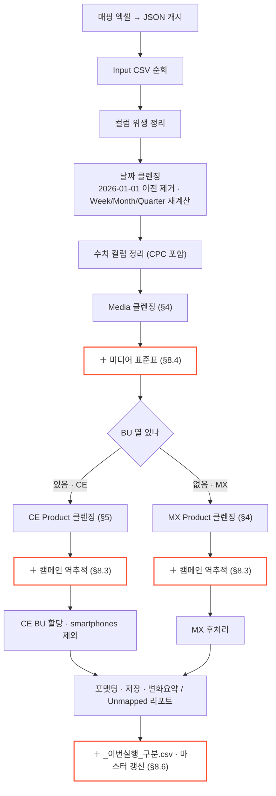
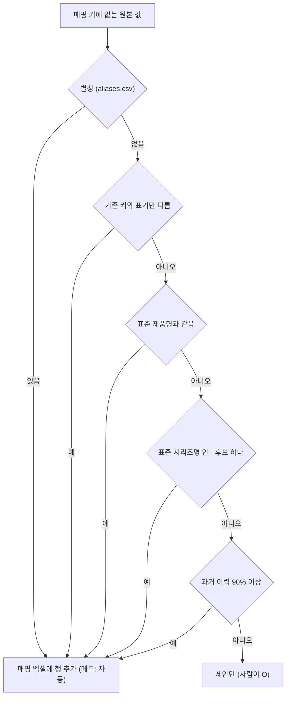

# GMO_Cleansing Pipeline (클렌징 중심)

이 문서는 실제 코드 중 **클렌징 로직**만 설명합니다.  
범위: 전처리, 정규화, 매핑, 보정, 리포트용 출력, 그리고 그 위에 얹은 고도화(§8)  
제외: 수집 · 취합 · 메일 운영(→ [README](../README.md)), 마스터 업데이트 세부(§8.6 에 요약만)

> §1~§7 은 기존 코어(`src/pipeline.py`)로 **그대로**다(2026-10-20 기준 변경 0줄). 고도화는 모두 코어 앞뒤에 붙였다 — §8.

---

## 1. 클렌징 실행 흐름

빨간 테두리(＋) = 고도화로 얹은 단계. 나머지는 기존 코어 그대로.

핵심 역할:
- `src/pipeline.py`: 클렌징 코어 엔진
- `src/utils.py`: CSV 로드, 날짜 클렌징
- `run.py`: 실행 오케스트레이션(분기/저장 포함)

---

## 2. 전처리

### 2.1 컬럼 위생 정리 (`sanitize_column_headers`)

- BOM 제거
- 줄바꿈/중복공백/따옴표 제거
- 중복 컬럼명은 첫 컬럼 유지

효과:
- merge 키 컬럼명이 깨져 매핑이 실패하는 문제를 선제 차단

### 2.2 날짜 클렌징 (`process_and_filter_dates`)

순서:
1. 숫자형 값은 Excel serial date로 파싱 (`origin='1899-12-30'`)
2. 비숫자 값은 텍스트 날짜 파싱
3. 파싱 실패 건은 특수문자 정리 후 재파싱
4. 유효하지 않거나 `config.MIN_DATE`(**2026-01-01**, 2026 년만 추적) 이전 날짜 제거
5. `Date`를 `YYYY-MM-DD`로 표준화
6. `Week/Month/Quarter` 컬럼이 있으면 재계산

### 2.3 수치 컬럼 정리 (`process_metric_columns`)

#### 수치 변환
- 대상: `Impressions`, `Clicks`, `Media Spend (USD)`, `Media Spend`, `Orders`, `Revenue`, `App Install`
- 콤마 제거 후 `to_numeric(errors='coerce')`
- 결측/문자값은 `0`으로 보정
- `-`, `–`, `—`도 `0`으로 처리

#### CPC 계산
- 클릭 0 또는 무한대/결측은 0 처리

---

## 3. 텍스트 정규화 (`fast_normalize_text`)

아래 규칙을 순차 적용합니다.

1. 결측/공백 정리
2. `([a-z])([A-Z])` 소문자-대문자 경계 분리
3. `([A-Z])([A-Z][a-z])` 약어-일반단어 경계 분리
4. `(\d+)([a-zA-Z]+)` 숫자-문자 경계 분리
5. 전체 소문자/대문자 문자열만 Title Case(단어 앞 첫글자 대문자) 보정

예시:
- `s25ultra` -> `s25 ultra` -> `S25 Ultra`(4,5)
- `QLEDUltra` -> `QLED Ultra`(3)
- `ZFold7Fe` -> `Z Fold7 Fe` (2,4)

---

## 4. 공통 매핑 엔진 (Media + MX Product)

함수: `run_cleansing_pipeline`

### 4.1 처리 단계
1. 원본 index를 `original_index`로 보존
2. `_norm_*` 컬럼 생성
3. 매핑 테이블 merge
4. 우선순위 점수 계산(`priority`)
5. 원본 행 단위 최적 후보 1건 선택
6. fallback/rescue/pass-through 적용
7. unmapped 리포트 산출

### 4.2 점수 규칙

| 점수 | 조건 
|---|---|
| 4 | Cat + Series + Product 일치 
| 3 | Cat + Series 일치 
| 2 | Series 일치 
| 1 | key만 존재   
| 0 | key 없음 

매칭 특수값:
- `NONE`: 해당 레벨 검증 생략(CE - Product)
- `ANY`: 값이 비어있지 않으면 통과(Affiliate - Media Platform)

동점 처리:
- 같은 점수 다중 후보 시 매핑 파일내 선입력순으로 채택됨 -> 최종 더블체크 필수

### 4.3 Media 특수 처리

- 기본 key: `Media Platform`
- 단, Affiliate는 key를 `Media Type 2`로 변경
- Affiliate 매핑 성공 시 `Media Platform_cleaned`는 원문 플랫폼 복원
- Affiliate 매핑 실패 시:
  - raw 값으로 fallback
  - `Media Type 2_cleaned = 'Others'`
  - `Media Platform_cleaned = 원문`

### 4.4 MX Rescue

대상:
- 1차 결과가 `Multi` 또는 null인 행

보정 방식:
- `series_reverse_map`: 시리즈를 기준으로 카테고리 역추론
- `fallback_map`: 카테고리별 기본 시리즈(Other 우선) 지정
- rescue 성공 시 `Category/Series/Product_cleaned` 재기입
  - Product는 시리즈 값으로 채워 정규화(Fall back)

ex) input : Smartphones / S25 Series / Multi
    Standard Mapping : Multi : Multi / Multi / Multi 우선 매핑
    RESCUE : Smartphones / S25 Series / S25 Series

### 4.5 Valid Combination Pass-through

원본 `Category|Series|Product` 조합이 매핑 표준 조합에 이미 존재하면,
클렌징 결과를 원본으로 유지(불필요한 변형 방지)

### 4.6 Unmapped 판정 (MX/Media)

단순 `priority==0`이 아니라 아래 조건을 모두 만족해야 실제 Unmapped:
1. `priority == 0`
2. rescue 미성공
3. valid-combination pass-through 아님

---

## 5. CE 전용 Product 클렌징

함수: `run_ce_product_cleansing`

핵심 원칙:
- 카테고리 중심 매핑 + 중복 시리즈 오매핑 방지

### 5.1 로직 구조
1. 카테고리/시리즈 정규화
2. 카테고리 키(`A_Key`) 기준 1차 매핑
3. 카테고리별 시리즈 맵 생성(`series_map_by_cat`)
4. 시리즈 출현 빈도 집계(`seen_series_counts`)
5. 유일 시리즈만 전역 rescue 맵에 등록(`global_series_lookup`)
6. 케이스별 결과 결정

### 5.2 케이스별 처리
- 카테고리 정상 + 시리즈 정상 -> 표준값
- 카테고리 정상 + 시리즈 비정상 -> 카테고리 fallback(`Others` 우선, 없으면 `Multi`)
- 카테고리 비정상 + 시리즈 전역 유일 -> 전역 rescue
- 둘 다 비정상 -> `NON_CE_CATEGORY`

후처리:
- `NON_CE_CATEGORY`는 최종 표시 시 원본 카테고리/시리즈로 복구
- Unmapped 리포트는 실패 키를 별도 저장

### 5.3 CE 분기 추가 필터 (`run.py`)
- `IGNORE_KEYWORDS = ['smartphones']`
- CE에서 해당 카테고리(cleaned)가 있으면 후단에서 삭제

---

## 6. 후처리

### 6.1 공통
- `process_subsidiary_column`: 법인명 공백 정리

### 6.2 MX
- `process_mindset_column`: `cold` -> `Cold`
- `process_funding_column`: `gmo`/`local` 표준화

### 6.3 CE
- `assign_ce_division`
  - raw BU를 대문자로 초기화
  - `DIV_RULES`에 따라 카테고리 기반 BU override (APS/Mulit 원본유지)

---

## 7. 출력 파일 생성물

- `Cleaned_Result` CSV
- `Summary_Prod` CSV (제품 컬럼 변화 집계)
- `Summary_Media` CSV (미디어 컬럼 변화 집계)
- Unmapped 리포트 CSV (`Reports/Unmapped_Products.csv`, `Reports/Unmapped_Media.csv`) — `Division`(MX/CE) 열 포함, 0건이면 옛 파일을 지움
- ＋ `Summary_Campaign` CSV (캠페인 역추적 채움 · 교체 · 충돌), `Summary_MediaStd` CSV (표준표로 바뀐 미디어)
- ＋ `2_Output/_이번실행_<MX|CE>.csv` — 이번 실행분 전체(취합 단계가 읽음, 실행 시작 때 옛 파일 삭제)

---

## 8. 고도화 (+ 알파, 2026-10)

원칙: **기존 로직 + 알파, 대체가 아니다.** 매핑은 매핑 엑셀에 행을 더하고, 보정은 클렌징 결과가 빈 값 · Multi · Others 일 때만 채운다.

### 8.1 수집 보정 (`tools/collect.py`, 코어 입력 전)

| 문제 | 처리 |
|---|---|
| 법인마다 머리줄 이름이 다름 | 별칭: `Div` → BU, `Mon` → Month, `Local` → Funding (SETK 등) |
| 열이 밀려 미디어 값이 엉뚱한 칸에 (SEDA 월간 리포트) | 행 단위로 Type1 · Type2 · Platform 자리를 찾아 바로잡음 |
| S.com 하위 채널 | Sales Channel · Partner 의 Epp · app · web → `S.com` |
| 표기 | Funding `HQ` → `GMO`, BU `HA` → `DA` |
| 시트가 여러 개 | 날짜가 가장 최근인 GMO 시트 |

### 8.2 매핑 자동 추론 (`tools/auto_mapping.py`)

코어의 Rescue(§4.4)는 처음 보는 값도 분류 단위로 '구제'하면 Unmapped 리포트에 남기지 않는다(예: `Z Fold9` → Smartphones / Multi).
그래서 **원본에서 매핑 키 존재 여부를 직접** 보고, 법칙으로 확실한 것만 매핑 엑셀에 행을 더한다. 나머지는 `매핑등록.xlsx` 제안.

- 키는 코어와 같은 `fast_normalize_text`(§3)로 계산 — MX 는 대소문자 그대로 비교, CE 는 소문자
- 미디어는 자동 추론하지 않는다(§8.4)

### 8.3 캠페인 역추적 (`src/campaign.py` · `3_Config/campaign_rules.xlsx`)

캠페인명 택소노미(`CN~…_PR~<제품코드>_SB~<시리즈코드>_…`)와 키워드로 제품 분류를 채운다. 위치: Product 클렌징 직후, CE BU 할당 전.

| 상황 | 결과 |
|---|---|
| 코어 결과가 빈 값 · Multi · Other(s) + 규칙 맞음 | **채움** |
| 코어 결과가 구체적인데 규칙과 다름 | 그대로 · `Summary_Campaign` 에 '충돌' |
| 번들 규칙(`+`, 예: `s26\|f1h26 + buds`) · 원본보다 우선 = O | **교체** (예: → Multi) |
| 시작일 · 제외 키워드 | 예: 2026-07-01 이후 Watch Ultra → Watch Ultra2, Watch7 · 8 과 같이 나오면 제외 |

- 택소노미는 SETK · SEAU CE · SEPR 만. SEC · SEDA · SIEL 은 자유 텍스트라 키워드 규칙만
- 바뀐 행은 `Campaign_Rule` 열에 규칙 근거가 남는다. 끄기: `config.CAMPAIGN_BACKTRACE = False`

### 8.4 미디어 표준표 (`src/media_std.py` · `3_Config/media_taxonomy.csv`)

코어 Media 클렌징(§4.3) 결과를 D2C 표준표 조합으로 맞춘다. **미디어 매핑 엑셀에 새 플랫폼을 넣지 않는다.**

1. 약어 풀기(`media_aliases.csv`): PMAX → Performance Max, FB · IG → Meta, TTD → The Trade Desk
2. Type 1 이 표에 없으면 Type 2 로 찾음(Other / PerformanceMax → Shopping Ads)
3. Platform 이 비었거나 Other 류 → 표 `기본` 열(YouTube → Google), 없으면 그 Type 2 의 유일한 Platform
4. 그래도 표 밖 → Platform `Others`(DSP 는 `Other DSPs`), Type 2 밖 → Others / Others. Affiliate Platform 은 원본 유지
5. 원본 값은 `Media Platform (Raw)` 에 보존. 마스터 과거 행도 매 실행 같은 검사(`tools/master_media.py`)

### 8.5 CE 비제품 카테고리

SEPR CE 처럼 Epp · app · S.com 같은 비제품 값이 Product Category 로 들어오면 코어 규칙대로 클렌징하고, 매핑 엑셀에 **Multi** 행을 더해 처리한다(코드 분기 추가 없음).

### 8.6 마스터 갱신 요약 (`src/updater.py`)

- 법인별로 숫자(Spend · Revenue · Imp · Click · Order)가 **처음 달라진 날부터** 새 것으로 교체 — 분류만 바뀐 행은 교체되지 않는다
- 그래서 매핑 · 규칙만 바꿨을 때는 `run_all.py --remap`(법인 지정: `--remap SEPR,SETK`)으로 입력 기간 전체를 다시 쓴다
- 2026 이전 행은 마스터에서 정리됨(원본은 `2_Output/원본보존_20261020_2025이전/`)
